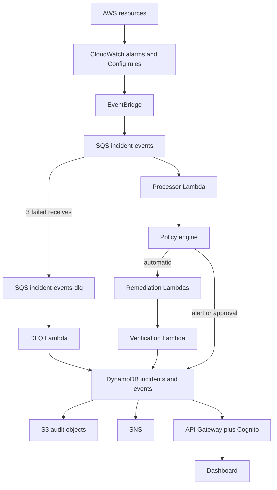

# Architecture

SentinelOps is a pipeline with a reader in front of it.

The policy decision and the lifecycle transitions live in `backend/src/pipeline/handle-signal.ts`. AWS calls live behind that function: the deployed processor invokes a worker Lambda, and the local API uses a scripted remediator. Tests exercise the real transitions without AWS.

## Lifecycle

`DETECTED → CLASSIFIED → REMEDIATION_PENDING → REMEDIATING → VERIFYING → RESOLVED`

Other terminals: `FAILED`, `REQUIRES_APPROVAL`, `REQUIRES_ATTENTION`.

`CLASSIFIED` is also the resting state for an unknown signal, because there is no action to take.

## Why these services

EventBridge is the front door. CloudWatch, Config, and a custom bus can all enter through rules without the processor knowing each producer.

SQS is the buffer. A burst of incidents waits in the queue. A failing handler is retried, then isolated on the dead-letter queue, without blocking the next message once partial batch failure is reported.

Lambda is the compute because each stage is a short, permissioned function. The processor is not allowed to call `s3:PutBucketPublicAccessBlock`. It can only invoke the function that is.

DynamoDB stores one item per incident, keyed by `incidentId`, plus a status index for the dashboard. Event identity lives in a second table so a duplicate delivery cannot create a second incident. The insert is a transaction: the event row is conditional on `attribute_not_exists(eventId)`.

## Idempotency

The first delivery claims the event id, then remediates. A second delivery of a resolved, approved, or attention incident returns the stored record. A failed delivery is resumed only when SQS increases `ApproximateReceiveCount`. Worker calls are written so a resumed attempt can repeat them: blocking public access again is the same configuration, and revoking a missing SSH rule is a successful no-op.

## What is intentionally absent

AWS Config recorder, CloudTrail organization trails, Step Functions, and CloudFront are not created. Config and CloudTrail events can be attached later by adding a rule that lands on the same queue. The processor already ignores sources it cannot classify into an approved action.
